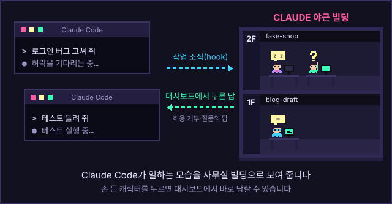

[한국어](README.ko.md)

# Claude Agent Office Viewer

A local dashboard that shows what Claude Code is doing as a small neon pixel office building. Each Claude Code session is a floor, each agent (lead, teammates) is a character at a desk, and a speech bubble shows the tool it is using right now. When Claude Code waits for you — a permission request, a question, a plan to approve — the character raises a hand, and you can answer from the dashboard.



The dashboard and installer messages are in Korean. This README and the [English guide](docs/manual/en.html) cover installing, starting and troubleshooting.

## Install

You need **Claude Code** (run it at least once) and **Node.js 24 or later**.

Download the installer for your OS from [Releases](https://github.com/gimdong/ClaudeAgentOfficeViewer/releases). Do not use the "Source code (zip / tar.gz)" archives — GitHub attaches them to every release, and they are not installers.

**macOS / Linux** (`claude-office-<version>.tar.gz`):

```bash
tar -xzf claude-office-<version>.tar.gz && cd claude-office-<version> && sh install.sh
```

**Windows** (`claude-office-<version>.zip`, in PowerShell — not PowerShell ISE; Windows is not yet verified in the beta):

```powershell
Expand-Archive claude-office-<version>.zip -DestinationPath . -Force; cd claude-office-<version>; powershell -ExecutionPolicy Bypass -File .\install.ps1
```

The installer asks two yes/no questions: whether to add the `claude-office` command to your PATH, and whether to install the Claude Code plugin (needed for speech bubbles and for answering from the dashboard). Program files go into `~/.claude-office` only. The archive includes the English guide as `manual-en.html` (also [here](docs/manual/en.html#install)).

## Start

```bash
claude-office
```

This starts the dashboard at `http://127.0.0.1:4317` and opens it in your browser. Keep that terminal window open; closing it (or pressing Ctrl+C) stops the dashboard.

- `claude-office open` opens the running dashboard in your default browser again; `claude-office open Safari` opens it in a named browser (macOS).
- `claude-office doctor` checks your setup; `claude-office diag` writes a diagnostics file to send to whoever supports you.
- `claude-office uninstall` removes it.
- Dashboard on a remote machine: `ssh -L 14317:127.0.0.1:4317 <host>`, run `claude-office url` on the remote machine, and open the printed address in your local browser with the port changed to `14317` ([manual](docs/manual/en.html#remote)).

## Security model

- **Local only.** The server listens on `127.0.0.1` only and rejects requests whose `Host` header is not a local address.
- **Key in the URL.** `claude-office` opens the dashboard with a one-time key in the address (`?k=…`). The browser keeps it as a cookie for a year; without it the dashboard shows a "key required" screen. This stops other web pages from answering permission requests for you. Do not share that address.
- **Same account only, on Linux.** On Linux, the server accepts a connection only if it comes from a process of the same user account (checked through `/proc/net/tcp`). A container with its own network is refused even under the same account. On macOS and Windows this check is **not** done. Encrypted hooks (beta.14) cannot be faked, but beta.14 still accepts the old plain HTTP hooks, so another account on the same computer can still send a fake one (for example, a fake permission request). The dashboard's data and answers (`/api`) still need the key.
- **Hook events are encrypted (from beta.14).** The plugin passes each hook event to a small relay program, which encrypts it with a key file only your account can read (`~/.claude-office/hook.key`), and accepts only an answer encrypted with the same key. Another account that takes port 4317 while the dashboard is off cannot read your prompts, tool inputs or results, and cannot answer for you; Claude Code simply asks in the terminal as usual.

  If you installed an earlier version, its plugin still sends plain HTTP hooks, and the dashboard shows `옛 플러그인(http hook)이 남아 있습니다 — 같은 압축 파일로 다시 설치하세요` ("An old plugin (http hook) is still installed — install again from the same archive"). Install again from the archive you downloaded; Claude Code windows that were already open keep the old hooks until you run `/reload-plugins` or restart them. Until then, the old risk remains: while the dashboard is off, another account on the same computer that takes port 4317 can receive your prompts, tool inputs and tool results, answer permission requests in your place, and add text to the conversation. beta.14 still accepts these old HTTP hooks, so this applies to anyone who has not installed again.

  If an unknown program holds port 4317, do not start the dashboard on another port; find out what it is and turn the plugin off until the port is free. `claude-office doctor` reports a program holding the port as `❌ 포트: 다른 프로그램이 4317을 쓰고 있습니다` ("another program is using 4317").
- **The dashboard reads `~/.claude` and never writes it.** It reads session records, transcripts and usage from your Claude data folder and writes nothing there. Only if you say yes, the installer registers the plugin through Claude Code's own `claude plugin` commands, which record it in Claude Code's plugin settings, and adds one PATH line to your shell profile.
- **The status line is changed only with your consent (macOS / Linux).** To fill the PLAN bar, the installer can connect to Claude Code's status line. Only if you answer yes in a terminal, or run the installer with `--statusline`, it changes `statusLine` in `~/.claude/settings.json` (backing up the original; the status line you used keeps showing). `--yes` alone does not turn it on. `claude-office uninstall` puts it back, but only if the status line is still the one the installer set; a status line you changed afterwards is left as it is. Windows does not support this.
- **Answers come only from you.** The plugin sends tool events to the dashboard. The dashboard returns an answer only for a request you answered on screen, or from rules you set yourself (permission policies, floor pausing, budgets). These rules work only while the dashboard is running; they prevent mistakes and are **not** a security boundary.
- **Floor controls can stop a Claude Code process you choose.** Before signalling they check the process id and start time from the session record, and they never signal on Windows.

## Experimental features

Sending instructions to a running floor and starting a new floor from the dashboard use Claude Code **channels**, a research preview feature. They are off until you turn them on in the dashboard ("실험 기능"). They need tmux 3.0 or later (macOS / Linux), Claude Code shows a development-channel warning each time a floor starts, and on Team / Enterprise accounts they do not work until an administrator allows channels. Behavior may change with Claude Code updates.

**Working with the lead** (same experimental feature, only on floors with a channel connection): request reports from a floor's lead and approve them or send revisions, answer the lead's or a teammate's questions from the dashboard, send teammates off duty or let them go with a handover note. On floors you opened yourself in a terminal these buttons are dimmed. See the [manual](docs/manual/en.html#lead).

## For administrators

Managed settings to allow the plugin (and, for plugins from earlier versions, its local HTTP hook URL), and what the PLAN bar shows for each plan: [docs/admin.md](docs/admin.md).

## Building from source

```bash
npm install
npm run build
npm start            # http://127.0.0.1:4317
```

`npm run dev` runs Vite and the API server together. `npm test` runs the tests, `npm run typecheck` the type check. Developer notes are in [README.ko.md](README.ko.md) (Korean).

## License

[MIT](LICENSE). The pixel font is [Galmuri](https://github.com/quiple/galmuri) (SIL Open Font License 1.1); see [THIRD_PARTY_NOTICES.md](THIRD_PARTY_NOTICES.md).
